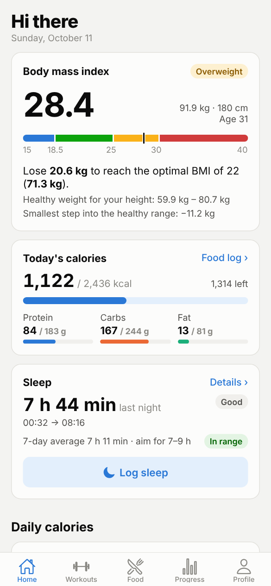
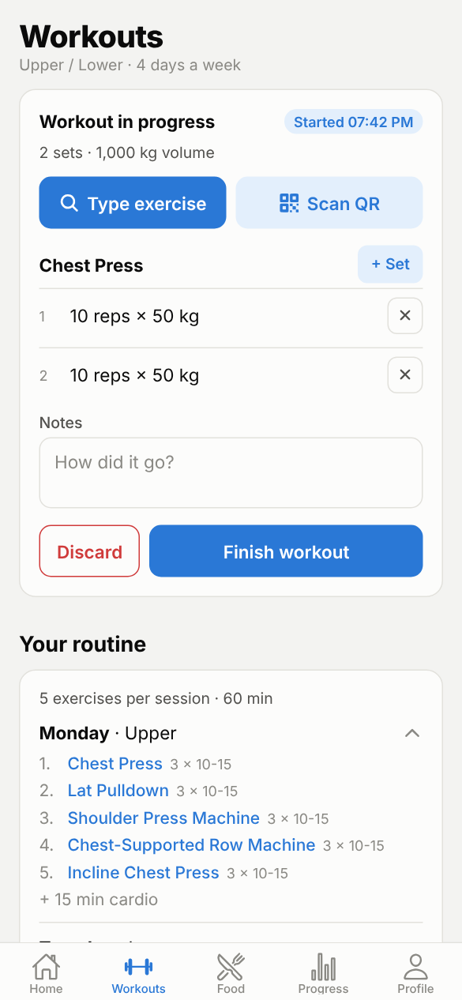
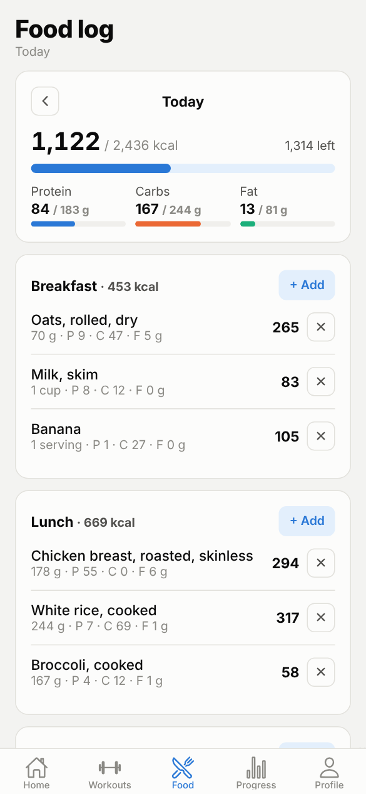
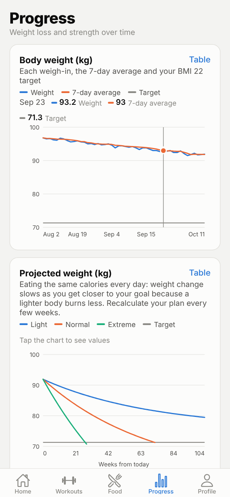

# Fitness App

Sign up, get your BMI, daily calories and a workout plan, then log workouts, food and body measurements and watch your progress on charts.

The project has two parts:

- **Backend** (this folder): **FastAPI + SQLModel**. It also serves a quick **web preview** at http://localhost:8000 that needs nothing else installed.
- **Mobile app** ([`mobile/`](mobile/)): **React Native + Expo**. Runs on your phone with the Expo Go app, or in your PC's browser. See [mobile/README.md](mobile/README.md).

The design is in [ARCHITECTURE.md](ARCHITECTURE.md).

| Home | Workouts | Food | Progress |
|---|---|---|---|
|  |  |  |  |

## Run the backend on your PC

You need [uv](https://docs.astral.sh/uv/) (it installs Python 3.13 and all packages for you) and git.

**1. Install uv** (once)

Windows (PowerShell):
```powershell
powershell -ExecutionPolicy ByPass -c "irm https://astral.sh/uv/install.ps1 | iex"
```
macOS / Linux:
```bash
curl -LsSf https://astral.sh/uv/install.sh | sh
```
Close and reopen the terminal afterwards.

**2. Get the code**
```bash
git clone https://github.com/EyadAlayed506/fitness-app.git
cd fitness-app
```

**3. Install, add demo data, start**
```bash
uv sync
uv run python -m app.demo
uv run fastapi dev app/main.py
```

**4. Open http://localhost:8000** and log in with **demo@fitness.app / demo1234**, or sign up with your own email. This is the web preview.

**5. The mobile app:** follow [mobile/README.md](mobile/README.md). In short, start the backend with `uv run fastapi dev app/main.py --host 0.0.0.0`, then in a second terminal `cd mobile`, `npm install`, `npx expo start`, and scan the QR code with Expo Go (or press `w` for the browser). You need Node.js 20+ for this part.

The demo account has ten weeks of weigh-ins, workouts, food logs and measurements, so every chart has data. Running `uv run python -m app.demo` again resets it.

Also useful:
- **http://localhost:8000/docs** – interactive API documentation (try every endpoint).
- `uv run pytest` – run the tests.
- Stop the server with `Ctrl+C`.

## What works

| Area | What you can do |
|---|---|
| Account | Sign up (with an "email me ads and discounts" checkbox), log in, delete account |
| Profile | Birth date, sex, height, weight, activity level, goal, diet, training days, minutes per session, equipment, kg/cm or lb/in |
| Health plan | BMI + category, healthy weight range, kg to lose/gain for BMI 22, resting and maintenance calories, light / normal / extreme diet with calorie difference, kg per week and weeks to goal |
| Routine | Pick the **weekdays you train** (e.g. Sun / Tue / Thu); sessions go on those days only, the rest are rest days. The app recommends a session for each day (1–3 days: full body every day) and says why. **Edit plan** lets you pick any session type per day (e.g. Full, Full, Upper) and give each day your own name; "Use recommended" goes back |
| Today (Home) | Rule-based suggestions with their reasons: today's session or a rest day, "consider going lighter" after a short night or low WHOOP recovery, missed sessions (never "make them up"), when to add weight. Your plan is never changed for you |
| Workouts | Start a workout, add exercises by **typing the name** (typos are fine) or **scanning the machine's QR code**, log reps, weight (kg or lb), RPE and notes. Each exercise has how-to steps and **alternatives** from the library ("similar movement" or "different movement") |
| Rest timer | Starts by itself after every set with that exercise's rest time; pause, resume, skip, restart, ±15 s (remembered per exercise); vibrates (or beeps in the browser) at zero |
| Weekly summary | Progress tab → Week: sessions done vs planned, each lift against last time, records, sleep, weight goal and points, compared with the week before; planned vs done for 8 weeks |
| Wellness points | Points for finished workouts, a full planned week, reaching your sleep goal, eating to plan and weekly weigh-ins; levels and achievements. Never taken away, no penalties for rest days |
| QR stickers | Workouts tab → "Print QR stickers" shows a printable code for every machine |
| Food | Search the built-in list, **USDA FoodData Central** and **Open Food Facts**; units change with the food (g/kg/oz/lb for solids, ml/l/cup/gallon… for drinks, or servings); create custom foods by hand with all macros and sub-macros |
| Progress | Weight trend, projected weight per diet option, calories vs target, macros, lift progress (estimated 1RM), weekly volume per body region, sleep per night (mobile app), month-to-month body measurements with body-fat estimate |
| Sleep (mobile app) | Choose how to track: **type it in** or **connect WHOOP** (sleep, stages, sleep performance and recovery imported automatically). Log bedtime, wake-up time, quality and notes; set a sleep goal (or use the amount recommended for your age); last night against the goal, sleep stages for WHOOP nights, a 7-night chart with the goal line, this week vs the week before, and bedtime / wake-up consistency. Overlapping entries are refused so a night isn't counted twice |
| Emails | Opt in/out on the Profile screen (the avatar at the top of Today); every user has a one-click unsubscribe link (`/api/marketing/unsubscribe/{token}`) |

**Scanning QR codes:** on a PC with a webcam it works at `http://localhost:8000`. To test, open the QR sticker page on your phone and hold it up to the webcam, or type the code printed under the sticker (e.g. `leg-press`).

**Using it from your phone:** use the mobile app in [`mobile/`](mobile/) with Expo Go. Its camera scans QR codes directly.

## Settings

Copy `.env.example` to `.env` (in the `fitness-app` folder) to change settings. The backend reads that file wherever you start it from; restart it after a change:

| Setting | Default | Notes |
|---|---|---|
| `DATABASE_URL` | `sqlite:///./fitness.db` | A file next to the app. PostgreSQL works too (needs `uv add "psycopg[binary]"`) |
| `JWT_SECRET` | a development value | **Change it** before putting the app online |
| `JWT_EXPIRE_MINUTES` | `30` | How long a login lasts |
| `USDA_API_KEY` | `DEMO_KEY` | `DEMO_KEY` allows only a few searches per hour. Get a free key at https://api.data.gov/signup/ |
| `OFF_USER_AGENT` | `FitnessApp/0.1 (...)` | Open Food Facts asks apps to identify themselves |
| `WHOOP_CLIENT_ID`, `WHOOP_CLIENT_SECRET` | empty (WHOOP off) | From your app at https://developer.whoop.com (needs a WHOOP membership). Without them the app offers manual sleep logging only |
| `WHOOP_REDIRECT_URI` | `http://localhost:8000/api/whoop/callback` | Must match the redirect URL registered in the WHOOP dashboard exactly |

### Connecting WHOOP

Why the app says "WHOOP isn't set up on this server yet": WHOOP only lets registered apps read sleep data, and each app gets its own Client ID and Client Secret from WHOOP. Nobody can ship those keys inside the code, so whoever runs the backend registers once (free, but it needs a WHOOP membership):

1. Go to https://developer.whoop.com, log in with your WHOOP account and open the Developer Dashboard. Create a team if it asks, then create an app.
2. Scopes: `read:profile`, `read:sleep`, `read:recovery` and `offline`. Redirect URL: `http://localhost:8000/api/whoop/callback`, exactly (the app's Sleep screen shows the URL your server expects).
3. In the `fitness-app` folder, make the settings file if you don't have one: `copy .env.example .env` (Windows) or `cp .env.example .env` (Mac/Linux). Open `.env` and paste the keys:
   ```
   WHOOP_CLIENT_ID=paste-the-client-id
   WHOOP_CLIENT_SECRET=paste-the-client-secret
   ```
   Keep the secret to yourself: don't commit `.env` or paste it into chats.
4. Stop the backend (Ctrl+C) and start it again. Its console now says `WHOOP: on`. If it says `WHOOP: off`, it also prints which `.env` file it read.
5. In the app: Sleep → **Connect WHOOP**. Do this from the browser on your PC (press `w` in Expo), because the WHOOP login sends you back to `localhost`. The connection belongs to your account, so the phone app syncs too afterwards.

The app imports the last 30 days, then syncs again when you open Home or the Sleep screen (at most every 15–30 minutes) or tap **Sync now**. WHOOP nights replace nights you typed in by hand for the same time.

### Coach (AI chatbot), voice and photos

The **Coach** tab is a chat assistant for training, sleep and food. It answers from your own logged data (profile and calorie plan, training plan, today's suggestions, workouts, lift history, the exercise library, sleep, food, weekly summary, points) and **logs things for you**: say "add a banana to breakfast" and it's in the Food tab straight away. It can log food, workout sets, a weigh-in and a night of sleep; every change shows under its answer with **Open** and **Undo**. You can also **talk to it**: tap the microphone, speak, tap again; the words appear in the box to check and send.

In **Workouts**, the **Photo** button recognises a machine from a picture (choose one from your files or gallery, or use the camera) and suggests up to 3 exercises from the library; you tap the right one.

It can run on two kinds of AI. `ASSISTANT_PROVIDER=auto` (the default) uses Claude when `ANTHROPIC_API_KEY` is set, otherwise Ollama. Voice and photos always run on your PC.

**Free, on your PC (Ollama)**, the default:
1. Install Ollama from https://ollama.com and leave it running.
2. Download the models once:
   ```
   ollama pull qwen3:8b       # the coach (about 5 GB)
   ollama pull qwen3-vl:8b    # photos of machines (about 6 GB)
   ```
   Both fit a 12 GB graphics card such as an RTX 4070 Super, one at a time: Ollama switches between them by itself, so the first answer after switching is slower.
3. Start the backend. Its console says `Coach: Ollama on this PC (qwen3:8b ...)`.
4. Voice messages use Whisper. It downloads by itself the first time you send one (about 500 MB, needs internet once) and runs on the processor. With NVIDIA's CUDA libraries installed you can set `WHISPER_DEVICE=cuda` and `WHISPER_COMPUTE_TYPE=float16` for speed. `WHISPER_LANGUAGE=en` (or `ar`, ...) skips language detection.

To try other models: `ollama pull <name>`, then set `OLLAMA_MODEL` (must support tools, e.g. `llama3.1:8b`) or `OLLAMA_VISION_MODEL` (must read images, e.g. `gemma3:12b`) in `.env` and restart. `OLLAMA_NUM_CTX` (default 16384) is how much text the coach can look at once; lower it if your graphics card runs out of memory.

Good to know: free, no daily limit, and your data, voice and photos stay on your PC. Answers and photo guesses are weaker than Claude's, so check what it logged and use Undo when it's wrong. The backend and Ollama must be running for the phone app's Coach and Photo to work.

**Paid, online (Claude):** create an API key at https://console.anthropic.com, put `ANTHROPIC_API_KEY=...` in `.env` and restart. Better answers; a question usually costs a few US cents and `ASSISTANT_DAILY_LIMIT` (default 50 per user per 24 hours) keeps the bill predictable. The data the assistant reads is sent to Anthropic. `ASSISTANT_MODEL` defaults to `claude-opus-5-5`.

Either way it's an AI: it's told to quote your numbers, say when data is missing and not give medical advice, but it can still be wrong.

## Project layout

```
fitness-app/
├── mobile/              # React Native (Expo) app – see mobile/README.md
├── app/
│   ├── main.py          # FastAPI app; serves the API under /api and the web preview at /
│   ├── config.py        # settings from .env
│   ├── database.py      # engine and session
│   ├── security.py      # password hashing (Argon2) and login tokens (JWT)
│   ├── deps.py          # CurrentUser / CurrentProfile dependencies
│   ├── models/          # SQLModel tables and request/response schemas
│   ├── routers/         # one file per area: auth, me, exercises, workouts, foods, measurements, sleep, whoop, analytics, points, marketing
│   ├── services/        # formulas, training days + routine, alternatives, suggestions, weekly summary, points, units, food search, WHOOP, QR codes
│   ├── seed/            # starter machine catalogue (48 exercises) and 38 common foods
│   ├── static/          # web preview (HTML, CSS, JS, Chart.js), served at /
│   └── demo.py          # demo account
└── tests/               # pytest: formulas, units, training days, routine, suggestions, points, weekly summary, sleep, WHOOP, every API area
```

Not built yet (see the build phases in ARCHITECTURE.md): Health Connect / Apple Health, food photos and label scanning, sending marketing emails (provider chosen later), database migrations, publishing the app to the App Store / Google Play.

The calculations are standard estimates (Mifflin–St Jeor, 7,700 kcal per kg, Epley, U.S. Navy body fat), not medical advice.
