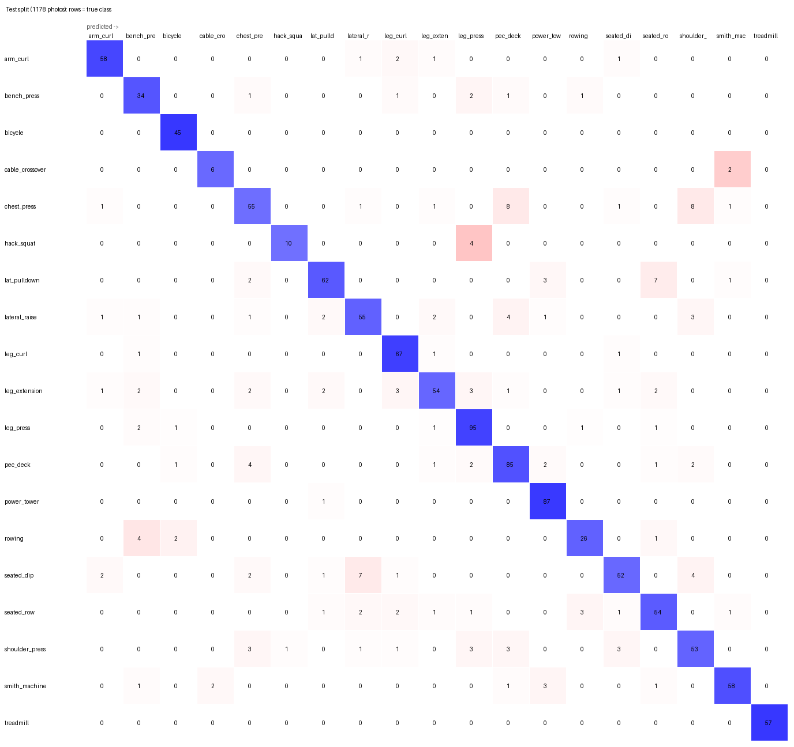
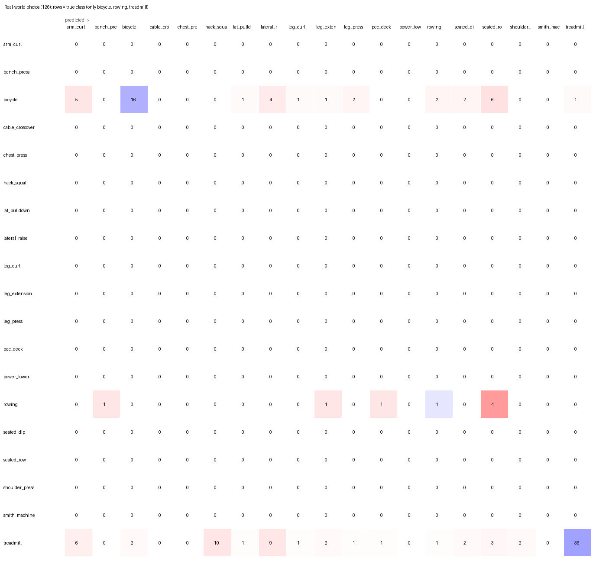

# Gym-machine classifier (MobileNet, PyTorch)

A small image classifier that tells which gym machine a photo shows, sized for phones. The current model is a
fine-tuned **MobileNetV3-Large** (ImageNet weights, 224×224 input) that knows **19 machines**. It is trained in
PyTorch and exported to ONNX and TFLite.

| | |
|---|---|
| Machines (19) | arm_curl, bench_press, bicycle, cable_crossover, chest_press, hack_squat, lat_pulldown, lateral_raise, leg_curl, leg_extension, leg_press, pec_deck, power_tower, rowing, seated_dip, seated_row, shoulder_press, smith_machine, treadmill |
| Test split (1,178 photos) | **accuracy 0.860, macro-F1 0.850** |
| Real-world photos (126, 3 machines) | accuracy 0.421, macro-F1 0.447 |
| Phone model | `model/merged/gym_machines_float16.tflite`, 6.0 MB |
| Backend model | `model/merged/gym_machines.onnx`, 12 MB, ~2 ms per photo on a desktop CPU |

The earlier 6-class model (TensorFlow) is still in `model/` and described under [Baseline](#baseline-6-classes-tensorflow).
On the same photos, the new model is as good as the old one, with three times as many machines to choose from. But
in real gym photos it often mistakes the cardio machines for strength machines (see [Limits](#limits)).

## Data

`prepare_roboflow.py` merges three sources into one classification set (`data/merged`, report in
`results/merged/dataset_report.json`):

| Source | Licence | What it adds |
|---|---|---|
| [Gym-Equipment-Classifier](https://github.com/siddharthkhincha/Gym-Equipment-Classifier), cleaned by `prepare_data.py` (below) | MIT | 1,455 photos, 6 classes, mostly product shots |
| ["Gym Equipment" by TheStalkers project](https://universe.roboflow.com/thestalkers-project/gym-equipment-ersfc) (Roboflow Universe, v1) | CC BY 4.0 | 13 strength machines, object detection, many photos taken in gyms |
| ["All Gym Equipment" by FitFuel](https://universe.roboflow.com/fitfuel/all-gym-equipment) (Roboflow Universe, v2) | CC BY 4.0 | 29 classes incl. free weights and cardio, object detection |

The Roboflow sets are object-detection exports (COCO format), so they need work before they can train a classifier:

- **One photo per machine.** Each labelled box is cropped out with a 10 % margin; boxes under 48 px are skipped.
- **Edited copies.** Roboflow stretched every photo to 640×640, and each of its training photos exists only as 3
  edited copies (TheStalkers: crop, rotation, shear, noise; FitFuel: random 90° turns). One copy in three is kept.
- **Upright photos.** FitFuel's copies are often sideways or upside down. ImageNet models could not tell which way is
  up (they picked the upright version only 31–41 % of the time, against 25 % by chance). So a small network is trained
  to recognise 90° turns from photos known to be upright (the 6-class training photos and TheStalkers' unedited
  photos). It recognises the turn in **93 %** of FitFuel's unedited photos, which it never saw. For each photo it keeps
  the copy it is surest about, turned upright.
- **File-name groups.** Roboflow file names are not unique (`images`, `naver_0006`, ...). Edited copies are grouped
  by name and labels, and a group always stays in one split, so copies of one photo cannot leak across splits.
- **One label list.** Labels are mapped onto one list: for example "chest fly machine" → pec_deck, "Stationary Bike" →
  bicycle, "Functional Trainer" → cable_crossover, "Leg Raise Tower" and "chinning dipping" → power_tower, "Preacher
  Curl" → arm_curl, and FitFuel's plain "Bench" → bench_press (so that class now means any bench).
- **Dropped classes.** Free weights and accessories (dumbbells, barbells, kettlebells, ab roller, stability ball) are
  dropped. So are machines with fewer than 40 photos: ab crunch (14), ab bench (15), elliptical (17), stepmill (24),
  GHD (30) and back extension (35).
- **Duplicates.** Near-identical photos (difference hash, as in `prepare_data.py`) are removed across all sources:
  682 removed, 7,527 photos kept.
- **Split.** The 6-class photos keep their split from `prepare_data.py`, so the old test photos are still test
  photos. Everything else is split 70/15/15 per class at random (seed 42). Roboflow's own valid/test photos are
  unedited, but they cover only some machines (TheStalkers has none for chest press, lat pulldown or power tower).
  So validation and test also contain edited copies, which makes them a little harder, not easier.

Result: **7,816 images: 5,467 train / 1,171 val / 1,178 test.**

| Machine | Train | Val | Test | | Machine | Train | Val | Test |
|---|---:|---:|---:|---|---|---:|---:|---:|
| arm_curl | 290 | 67 | 63 | | leg_press | 465 | 98 | 101 |
| bench_press | 185 | 40 | 40 | | pec_deck | 453 | 98 | 98 |
| bicycle | 207 | 44 | 45 | | power_tower | 393 | 79 | 88 |
| cable_crossover | 34 | 8 | 8 | | rowing | 155 | 33 | 33 |
| chest_press | 339 | 73 | 76 | | seated_dip | 322 | 69 | 69 |
| hack_squat | 68 | 14 | 14 | | seated_row | 326 | 69 | 66 |
| lat_pulldown | 332 | 75 | 75 | | shoulder_press | 319 | 68 | 68 |
| lateral_raise | 327 | 70 | 70 | | smith_machine | 311 | 66 | 66 |
| leg_curl | 344 | 70 | 70 | | treadmill | 264 | 57 | 57 |
| leg_extension | 333 | 73 | 71 | | | | | |

**Real-world check:** 126 everyday photos from [Open Images V7](https://storage.googleapis.com/openimages/web/index.html)
(images CC BY 2.0, labels CC BY 4.0): treadmill 77, bicycle 41, rowing 8 (`realworld/realworld.json`,
`prepare_realworld.py`). Used only to score the final model.

## Training and model selection (19 machines)

The same three phases as for the baseline, now in PyTorch on an RTX 4070 Super. All choices were made on the
validation split; the test split and the real-world photos were scored once, on the final model only.

**Phase A, frozen backbone** (`search_frozen.py`; best head per backbone, val macro-F1): v3_small 0.732 @160 /
0.750 @224, v3_large 0.750 @160 / 0.753 @224. 224 px is kept.

**Phase B, fine-tuning grid** (`search_finetune.py`): unfreeze {0.3, 0.6, 1.0} × ft_lr {1e-4, 3e-4, 1e-3}, with
strong augmentation, label smoothing 0.1, dropout 0.2, no hidden layer, weight decay 1e-4. One seed per cell.

| Backbone | Unfreeze | ft_lr | Val acc | Val macro-F1 | Trainable params | Minutes |
|---|---:|---:|---:|---:|---:|---:|
| v3_small | 0.3 | 1e-4 | 0.775 | 0.772 | 726,139 | 4.1 |
| v3_small | 0.3 | 3e-4 | 0.815 | 0.804 | 726,139 | 2.9 |
| v3_small | 0.3 | 1e-3 | 0.832 | 0.827 | 726,139 | 3.0 |
| v3_small | 0.6 | 1e-4 | 0.782 | 0.779 | 846,707 | 3.3 |
| v3_small | 0.6 | 3e-4 | 0.817 | 0.805 | 846,707 | 3.5 |
| v3_small | 0.6 | 1e-3 | 0.849 | 0.836 | 846,707 | 3.0 |
| v3_small | 1.0 | 1e-4 | 0.792 | 0.789 | 925,859 | 3.0 |
| v3_small | 1.0 | 3e-4 | 0.817 | 0.808 | 925,859 | 3.0 |
| v3_small | 1.0 | 1e-3 | 0.841 | 0.828 | 925,859 | 3.3 |
| v3_large | 0.3 | 1e-4 | 0.849 | 0.849 | 2,486,371 | 4.3 |
| v3_large | 0.3 | 3e-4 | 0.878 | 0.875 | 2,486,371 | 3.2 |
| v3_large | 0.3 | 1e-3 | 0.860 | 0.860 | 2,486,371 | 3.0 |
| v3_large | 0.6 | 1e-4 | 0.860 | 0.850 | 2,897,315 | 3.2 |
| **v3_large** | **0.6** | **3e-4** | **0.887** | **0.885** | 2,897,315 | 4.5 |
| v3_large | 0.6 | 1e-3 | 0.415 | 0.344 | 2,897,315 | 3.2 |
| v3_large | 1.0 | 1e-4 | 0.861 | 0.851 | 2,965,811 | 3.6 |
| v3_large | 1.0 | 3e-4 | 0.879 | 0.880 | 2,965,811 | 3.8 |
| v3_large | 1.0 | 1e-3 | 0.466 | 0.416 | 2,965,811 | 3.7 |

- **The large backbone wins clearly** with 19 machines: about 4–5 points over the small one, well beyond the noise.
- **ft_lr 1e-3 is too high for the large backbone** once 60 % or more of it is trained: those two runs fell apart
  (0.42 and 0.47).

**Phase C, more seeds** (`confirm_top.py --top 3`; macro-F1 for seeds 42, 1, 2, 3):

| Setting | Macro-F1 per seed | Mean macro-F1 | Mean acc |
|---|---|---:|---:|
| **v3_large, unfreeze 0.6, ft_lr 3e-4** | 0.885, 0.878, 0.884, 0.877 | **0.881 ± 0.004** | **0.884** |
| v3_large, unfreeze 1.0, ft_lr 3e-4 | 0.880, 0.858, 0.878, 0.875 | 0.873 ± 0.010 | 0.875 |
| v3_large, unfreeze 0.3, ft_lr 3e-4 | 0.875, 0.861, 0.867, 0.871 | 0.869 ± 0.006 | 0.871 |

Final model: **MobileNetV3-Large @224, unfreeze 0.6, ft_lr 3e-4** (seed-42 run). Logs: `results/merged/search/`.

## Final results (19 machines, `results/merged/final_metrics.json`)

| Split | Photos | Accuracy | Macro-F1 |
|---|---:|---:|---:|
| Validation (used for selection) | 1,171 | 0.887 | 0.885 |
| **Test** | 1,178 | **0.860** | **0.850** |
| **Real-world** (3 machines) | 126 | **0.421** | **0.447** |

### Test split, per machine

| Machine | Photos | Precision | Recall | F1 | | Machine | Photos | Precision | Recall | F1 |
|---|---:|---:|---:|---:|---|---|---:|---:|---:|---:|
| arm_curl | 63 | 0.921 | 0.921 | 0.921 | | leg_press | 101 | 0.864 | 0.941 | 0.900 |
| bench_press | 40 | 0.756 | 0.850 | 0.800 | | pec_deck | 98 | 0.825 | 0.867 | 0.846 |
| bicycle | 45 | 0.918 | 1.000 | 0.957 | | power_tower | 88 | 0.906 | 0.989 | 0.946 |
| cable_crossover | 8 | 0.750 | 0.750 | 0.750 | | rowing | 33 | 0.839 | 0.788 | 0.812 |
| chest_press | 76 | 0.786 | 0.724 | 0.753 | | seated_dip | 69 | 0.867 | 0.754 | 0.806 |
| hack_squat | 14 | 0.909 | 0.714 | 0.800 | | seated_row | 66 | 0.806 | 0.818 | 0.812 |
| lat_pulldown | 75 | 0.899 | 0.827 | 0.861 | | shoulder_press | 68 | 0.757 | 0.779 | 0.768 |
| lateral_raise | 70 | 0.821 | 0.786 | 0.803 | | smith_machine | 66 | 0.921 | 0.879 | 0.899 |
| leg_curl | 70 | 0.870 | 0.957 | 0.912 | | treadmill | 57 | 1.000 | 1.000 | 1.000 |
| leg_extension | 71 | 0.871 | 0.761 | 0.812 | | | | | | |



The mistakes are mostly between machines that look alike: chest press ↔ pec deck and shoulder press, hack squat →
leg press, lat pulldown → seated row, seated dip → lateral raise, cable crossover → smith machine.

### Compared with the 6-class model, on the same photos

| Photos | 6-class model | 19-machine model | 19-machine model, answers limited to the old 6 |
|---|---:|---:|---:|
| Old 6-class test split (217) | 0.908 | **0.903** | 0.908 |
| Real-world (126) | 0.571 | **0.421** | **0.754** |

- **Old test photos:** the new model is as accurate as the old one, while choosing among 19 machines instead of 6.
- **Real-world photos:** limited to the old 6 answers, it is much better (0.754 vs 0.571), so it recognises
  machines in real photos better. With all 19 answers allowed, it often names a strength machine instead.
  Treadmills were taken for hack squat (10), lateral raise (9) and arm curl (6); bikes for seated row (6) and arm
  curl (5).
- **Why:** this is a bias in the data. The cardio machines (treadmill, bicycle, rowing) come only from the 6-class set,
  which is mostly product photos on plain backgrounds. Most strength-machine photos come from Roboflow and were taken
  inside gyms. The model has partly learned that a gym background means a strength machine.



## Exports (`model/merged/`)

Every export was checked against the PyTorch model on the 1,178 test photos. Speed is the median for one photo at a
time on a desktop CPU (Ryzen 5 7600, 4 threads); phones will be slower.

| File | Size | Test acc | Same prediction as PyTorch | ms / photo |
|---|---:|---:|---:|---:|
| `gym_machines.onnx` (opset 17) | 11.95 MB | 0.860 | 100 % | 2.3 |
| `gym_machines_float32.tflite` | 11.96 MB | 0.860 | 100 % | 20.5 |
| `gym_machines_float16.tflite` | 6.02 MB | 0.860 | 100 % | 22.5 |
| `gym_machines_int8.tflite` (dynamic range) | 3.29 MB | 0.864 | 97.0 % | 240 |

- **Recommended:** `float16.tflite` for the app, and the ONNX file for the backend (onnxruntime).
- **How the TFLite files are made:** PyTorch → ONNX → TensorFlow with onnx2tf (which converts the layout to NHWC) →
  TensorFlow's TFLite converter.
- **Speed:** on this desktop CPU the TFLite files are about 10× slower than ONNX; measure on a phone before relying
  on these numbers. int8 was much slower still on this x86 CPU.

**Using the model** is the same as before: input is an RGB photo as float32 NHWC `[1, 224, 224, 3]` with pixel values
0–255 (the scaling is inside the model). Resize the short side to 256 px and crop the centre 224×224. The output is 19
softmax probabilities in `labels.txt` order.

## Try it on your own photos

```bash
python predict.py photo.jpg [more.jpg ...]   # top 3 guesses per photo
python predict.py some_folder                # every .jpg/.jpeg/.png in the folder
python try_model.py                          # a small window: pick a photo, see the guess
```

Both use `model/merged/` (falling back to the 6-class `model/` if it is missing; `--model model` picks the old one).
They say "not sure" when the top guess is under 50 %. Put one pair of quotes around a path that contains spaces.

## Train on with your own photos

Put your photos in `data/merged/train/<machine>/` (and some in `val/`), using the machine names above, then continue
from the current model with a lower learning rate, for example:

```bash
DATASET=merged python finetune.py '{"backbone": "mobilenet_v3_large", "size": 224, "aug": "strong", "unfreeze": 0.6, "ft_lr": 0.0001, "head_epochs": 0}' --init runs/merged/finetune/mobilenet_v3_large_224_g4/model.pt --name my_photos
DATASET=merged python evaluate_export.py runs/merged/finetune/my_photos/model.pt
```

`--init` needs the same machine list. A new machine means retraining from the ImageNet weights with the steps below.
Rerunning `prepare_roboflow.py` rebuilds `data/merged` from scratch, so keep your own photos in a separate folder too.

## How to reproduce

```bash
cd ml/machine_classifier
python -m venv .venv && source .venv/bin/activate      # Windows: .venv\Scripts\activate
pip install torch==2.11.0 torchvision==0.26.0 --index-url https://download.pytorch.org/whl/cu128   # NVIDIA GPU
pip install -r requirements.txt

python prepare_data.py                    # 6-class set     -> data/processed
python prepare_realworld.py               # real-world set  -> data/realworld
python prepare_roboflow.py --download     # merged set      -> data/merged (needs a Roboflow API key in ~/.roboflow_key,
                                          #  or the two COCO zips downloaded by hand into data/raw/roboflow/)
export DATASET=merged                     # PowerShell: $env:DATASET = "merged"
python search_frozen.py
BASE='{"aug": "strong", "label_smoothing": 0.1, "dropout": 0.2, "hidden": 0, "weight_decay": 0.0001}'
GRID='{"unfreeze": [0.3, 0.6, 1.0], "ft_lr": [0.0001, 0.0003, 0.001]}'
python search_finetune.py --backbone mobilenet_v3_small --size 224 --first "$BASE" --grid "$GRID"
python search_finetune.py --backbone mobilenet_v3_large --size 224 --first "$BASE" --grid "$GRID"
python confirm_top.py --top 3
python evaluate_export.py runs/merged/finetune/mobilenet_v3_large_224_g4/model.pt   # -> results/merged, model/merged
```

Notes:
- On an RTX 4070 Super a trial takes 3–4.5 minutes, and the whole run about 1.5 hours. The speed is limited by
  decoding photos on the CPU.
- Photos load in the main process (`WORKERS=0`), because loader worker processes hung on Windows. Set the `WORKERS`
  environment variable to try more.
- GPU runs are not bit-exact, so reruns differ slightly.
- `data/`, `runs/` and `.venv/` are not committed, and neither is the Roboflow key; the scripts recreate the rest.

## Limits

- **Real gym photos are the weak spot.** Cardio machines in gym photos are often called strength machines (real-world
  accuracy 0.42). The fix is in-gym photos of treadmills, bikes and rowers. Openverse lists hundreds of openly
  licensed ones, and your own photos would help too. Check any additions against `data/realworld` so the real-world
  check stays independent.
- **No "none of these" answer.** Any other machine or object is forced into one of the 19. The app should treat
  low-confidence predictions as unknown.
- **Stretched, edited photos.** The Roboflow photos were stretched to 640×640, and many exist only as edited copies.
  About 2/3 of val/test images are such copies, so the test score is not a clean-photo score.
- **Small classes.** cable_crossover (50 photos in all) and hack_squat (96) are thin; their test numbers rest on 8
  and 14 photos.
- **Noisy labels.** The Roboflow labels have some noise (for example an elliptical labelled as a bike). bench_press
  now means any bench.
- **Narrow real-world check.** The real-world set covers only 3 machines and has just 8 rowing photos.
- **Not added: a third dataset.** The 58-class "Gym Equipment" set by Xiaoshi was not included (no link yet).

---

## Baseline: 6 classes (TensorFlow)

The first model, kept in `model/` with its results in `results/`. It was trained with the earlier TensorFlow/Keras
version of these scripts (git history of this folder, branch `mobilenet-machines`).

**Data:** [Gym-Equipment-Classifier](https://github.com/siddharthkhincha/Gym-Equipment-Classifier) (MIT), 1,482
web-scraped photos. `prepare_data.py` pools its train/test folders (they share photos), removes exact (md5) and near
duplicates (difference hash ≤ 4 of 64 bits) with union-find (**26 removed**), drops **1 group** with conflicting
labels, and splits 70/15/15 per class with seed 42: **1,455 photos, 1,020 / 218 / 217.**

**Selection:**
- **Phase A (frozen backbone, val acc @224):** v2 0.890, v3_small 0.913, v3_large 0.913. 224 px beat 160 px.
- **Phase B (random search, then grid):** the unfreeze × ft_lr grid found v3_small with unfreeze 0.6 and ft_lr 1e-3
  best (val 0.959 / 0.956 on one seed). The same cell scored 0.928 on another machine, so single runs are noisy.
- **Phase C (4 seeds):** v3_small 0.6/1e-3 had mean macro-F1 0.938 ± 0.014, ahead of v3_small 1.0/1e-3
  (0.934) and v3_large 0.6/1e-3 (0.932).

Logs: `results/search/`.

**Results:**

| Split | Photos | Accuracy | Macro-F1 |
|---|---:|---:|---:|
| Test | 217 | 0.908 | 0.899 |
| Real-world | 126 | 0.571 | 0.582 |

**Exports** (all match Keras on the test photos; int8 differs on 2):

| File | Size |
|---|---:|
| float32.tflite | 3.77 MB |
| float16.tflite | 1.95 MB |
| int8.tflite | 1.13 MB |
| ONNX | 3.79 MB |

**PyTorch port check:** the same 6-class v3_small grid run with the PyTorch code gave val macro-F1 0.873–0.923
(TensorFlow: 0.892–0.956 on this PC, 0.902–0.932 on the cloud machine). The best cell was the same (unfreeze 0.6,
ft_lr 1e-3), and the low-learning-rate cells were again the worst.
