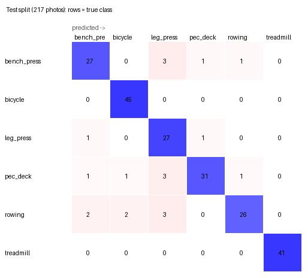
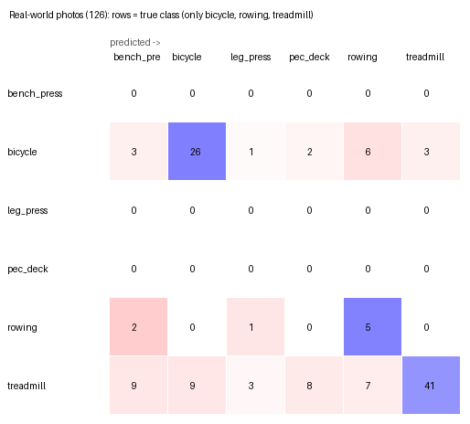

# Gym-machine classifier (MobileNet)

A small image classifier that tells which gym machine a photo shows, sized for phones. It is a fine-tuned
**MobileNetV3-Small** (ImageNet weights, 224×224 input), exported to TFLite and ONNX.

| | |
|---|---|
| Classes (6) | bench_press, bicycle, leg_press, pec_deck, rowing, treadmill |
| Test split (217 photos) | **accuracy 0.908, macro-F1 0.899** |
| Real-world photos (126, 3 classes) | accuracy 0.571, macro-F1 0.582 |
| Phone model | `model/gym_machines_float16.tflite`, 1.95 MB, ~1 ms per photo on a desktop CPU |

The real-world number is the honest one for in-gym use: the training photos are mostly product shots, and the model
loses a lot on everyday photos (see [Limits](#limits)).

## Data

### Training data: Gym-Equipment-Classifier

[siddharthkhincha/Gym-Equipment-Classifier](https://github.com/siddharthkhincha/Gym-Equipment-Classifier) (MIT
licence): 1,482 web-scraped photos in 6 classes. `prepare_data.py` cleans it:

- **Pooled, then re-split.** The repo's own train/test folders hold copies of the same photo on both sides, so all
  photos are pooled first.
- **Duplicates removed.** Exact copies (md5) and near-copies (difference hash, ≤ 4 of 64 bits apart: resized,
  recompressed or lightly edited versions) are grouped with union-find, and one photo (the largest) is kept per group.
  **26 duplicates were removed.**
- **Conflicting labels dropped.** **One group** contained the same photo under two different classes and was dropped
  entirely.
- **Split 70/15/15 per class, seed 42.** No photo, or a near-copy of it, is in two splits. Photos are stored with the
  short side at 256 px.

Result: **1,455 photos: 1,020 train / 218 val / 217 test** (`data/report.json`).

| Class | Train | Val | Test |
|---|---:|---:|---:|
| bench_press | 150 | 32 | 32 |
| bicycle | 207 | 44 | 45 |
| leg_press | 139 | 30 | 29 |
| pec_deck | 174 | 37 | 37 |
| rowing | 155 | 33 | 33 |
| treadmill | 195 | 42 | 41 |

### Real-world check: Open Images V7

126 everyday photos of gyms and homes from [Open Images V7](https://storage.googleapis.com/openimages/web/index.html)
(images CC BY 2.0, labels CC BY 4.0), listed in `realworld/realworld.json` and downloaded by `prepare_realworld.py`:
treadmill 77, bicycle 41 (exercise bikes), rowing 8. Open Images has no labels for the other three machines.
The set is used only to score the final model, never to choose it.

## Training and model selection

All choices were made on the validation split. The test split and the real-world photos were scored once, on the
final model only.

### Phase A: frozen backbone (`search_frozen.py`)

The ImageNet backbone stays frozen and only a classifier head is trained on its features (grid over hidden layer,
dropout, learning rate and label smoothing). This phase ran earlier on a 4-CPU cloud machine; best head per backbone:

| Backbone | Size | Best val acc | Val macro-F1 |
|---|---:|---:|---:|
| MobileNetV2 | 160 | 0.853 | 0.840 |
| MobileNetV2 | 224 | 0.890 | 0.884 |
| MobileNetV3-Small | 160 | 0.908 | 0.903 |
| MobileNetV3-Small | 224 | 0.913 | 0.906 |
| MobileNetV3-Large | 160 | 0.908 | 0.902 |
| MobileNetV3-Large | 224 | 0.913 | 0.905 |

224 px beat 160 px for every backbone. V2 was dropped. Full log: `results/search/frozen_search.json`.

### Phase B1: fine-tuning, random search (`search_finetune.py`, cloud machine)

Random search over augmentation, unfreeze share, fine-tune learning rate, label smoothing, dropout, hidden layer and
weight decay. Findings:

- Best: v3_small, `aug strong, unfreeze 0.3, ft_lr 3e-4, label_smoothing 0.1, dropout 0.2, hidden 0,
  weight_decay 1e-4`, giving **val acc 0.931, macro-F1 0.928**.
- v3_large with similar settings: 0.922–0.927.
- Head only (unfreeze 0): clearly worse, 0.83–0.90.

Full log: `results/search/finetune_search.json`. It also contains a partial run of the Phase B2 grid on the cloud
machine (see below).

### Phase B2: grid over unfreeze × learning rate (this run)

Same settings as the best above (`aug strong, label_smoothing 0.1, dropout 0.2, hidden 0, weight_decay 1e-4`),
with every combination of unfreeze {0.3, 0.6, 1.0} and ft_lr {1e-4, 3e-4, 1e-3}, for both backbones. One seed (42)
per trial; the CPU time is per trial on a Ryzen 5 7600.

| Backbone | Unfreeze | ft_lr | Val acc | Val macro-F1 | Trainable params | Minutes |
|---|---:|---:|---:|---:|---:|---:|
| v3_small | 0.3 | 1e-4 | 0.899 | 0.892 | 718,638 | 0.9 |
| v3_small | 0.3 | 3e-4 | 0.931 | 0.928 | 718,638 | 0.9 |
| v3_small | 0.3 | 1e-3 | 0.936 | 0.932 | 718,638 | 0.8 |
| v3_small | 0.6 | 1e-4 | 0.917 | 0.913 | 839,206 | 1.0 |
| v3_small | 0.6 | 3e-4 | 0.931 | 0.930 | 839,206 | 1.0 |
| **v3_small** | **0.6** | **1e-3** | **0.959** | **0.956** | 839,206 | 1.0 |
| v3_small | 1.0 | 1e-4 | 0.922 | 0.917 | 918,358 | 1.6 |
| v3_small | 1.0 | 3e-4 | 0.940 | 0.938 | 918,358 | 1.5 |
| v3_small | 1.0 | 1e-3 | 0.945 | 0.945 | 918,358 | 1.5 |
| v3_large | 0.3 | 1e-4 | 0.904 | 0.898 | 2,473,878 | 1.8 |
| v3_large | 0.3 | 3e-4 | 0.931 | 0.927 | 2,473,878 | 1.9 |
| v3_large | 0.3 | 1e-3 | 0.931 | 0.927 | 2,473,878 | 2.0 |
| v3_large | 0.6 | 1e-4 | 0.927 | 0.924 | 2,884,822 | 2.2 |
| v3_large | 0.6 | 3e-4 | 0.922 | 0.917 | 2,884,822 | 2.4 |
| v3_large | 0.6 | 1e-3 | 0.950 | 0.946 | 2,884,822 | 2.4 |
| v3_large | 1.0 | 1e-4 | 0.936 | 0.933 | 2,953,318 | 3.5 |
| v3_large | 1.0 | 3e-4 | 0.931 | 0.928 | 2,953,318 | 3.3 |
| v3_large | 1.0 | 1e-3 | 0.936 | 0.931 | 2,953,318 | 3.6 |

The v3_small (0.3, 3e-4) cell is exactly the Phase B1 best configuration and reproduces its score (0.931 / 0.928),
so it was not run a second time. On this machine a higher learning rate (1e-3) helped on both backbones, and
unfreezing 60 % of the layers was best for both. Log: `results/search/finetune_grid_windows.json`.

**The same seed does not give the same result on another machine.** The cloud machine had run the identical v3_small
grid (same configs, seed 42). Some cells match closely, for example (0.3, 3e-4) at 0.929 there versus 0.931 here, but
others do not: (0.6, 1e-3) scored **0.928** there and **0.956** here. CPU kernels round differently with different
thread counts, and those small differences grow over training. The cloud grid's best v3_small cell was (0.6, 3e-4) at
0.932, and its best v3_large cell (of the 4 it finished) was (0.6, 3e-4) at 0.934. One run per cell is therefore not
enough to pick a winner, which is why Phase C exists.

### Phase C: confirm with more seeds (`confirm_top.py --top 3`)

The validation split has only 218 photos, so one run's score is noisy (about ±2 %). The top 3 settings were retrained
with seeds 1, 2 and 3 and ranked by the mean over all 4 seeds:

| Setting | Macro-F1 per seed (42, 1, 2, 3) | Mean macro-F1 | Mean acc |
|---|---|---:|---:|
| **v3_small, unfreeze 0.6, ft_lr 1e-3** | 0.956, 0.939, 0.922, 0.935 | **0.938 ± 0.014** | **0.942 ± 0.013** |
| v3_small, unfreeze 1.0, ft_lr 1e-3 | 0.945, 0.932, 0.937, 0.921 | 0.934 ± 0.010 | 0.937 ± 0.008 |
| v3_large, unfreeze 0.6, ft_lr 1e-3 | 0.946, 0.922, 0.927, 0.931 | 0.932 ± 0.010 | 0.936 ± 0.010 |

The three are within noise of each other. **MobileNetV3-Small, unfreeze 0.6, ft_lr 1e-3** has the best mean, and it is
also the smaller and faster model on phones, so it is the final model. The exported weights are its seed-42 run. That
run's 0.956 validation score is the luckiest of the four seeds (and the same setting scored 0.928 on the cloud
machine), so its own validation score overstates it; the 4-seed mean of about 0.94 is the better guide. Log:
`results/search/confirm_windows.json`.

Final configuration (`model/model_card.json`): MobileNetV3-Small @ 224, strong augmentation, 5 epochs head-only at
lr 1e-3, then up to 15 epochs with the top 60 % of layers trainable (batch norm frozen), AdamW, cosine decay from
1e-3, weight decay 1e-4, label smoothing 0.1, dropout 0.2, no hidden layer, early stopping on val loss (patience 4).

## Final results (`evaluate_export.py`, `results/final_metrics.json`)

| Split | Photos | Accuracy | Macro-F1 |
|---|---:|---:|---:|
| Validation (used for selection) | 218 | 0.959 | 0.956 |
| **Test** | 217 | **0.908** | **0.899** |
| **Real-world** (3 classes) | 126 | **0.571** | **0.582** |

### Test split, per class

| Class | Photos | Precision | Recall | F1 |
|---|---:|---:|---:|---:|
| bench_press | 32 | 0.871 | 0.844 | 0.857 |
| bicycle | 45 | 0.938 | 1.000 | 0.968 |
| leg_press | 29 | 0.750 | 0.931 | 0.831 |
| pec_deck | 37 | 0.939 | 0.838 | 0.886 |
| rowing | 33 | 0.929 | 0.788 | 0.852 |
| treadmill | 41 | 1.000 | 1.000 | 1.000 |



Treadmills and bikes are almost always right. Most errors are other strength machines predicted as **leg_press**
(9 of the 20 errors), and rowing machines are sometimes taken for benches or bikes.

### Real-world photos, per class

| Class | Photos | Precision | Recall | F1 |
|---|---:|---:|---:|---:|
| bicycle | 41 | 0.743 | 0.634 | 0.684 |
| rowing | 8 | 0.278 | 0.625 | 0.385 |
| treadmill | 77 | 0.932 | 0.532 | 0.678 |



Precision is computed over the 3 classes present, but the model may also answer with the other 3 classes; many
errors are exactly that. Only 41 of 77 treadmills are recognised, with the rest spread over every other class. In
the training data a treadmill is a clean product shot; in a gym it is often partly hidden, at an angle or one of a
row of machines. Rowing has only 8 photos, so its numbers are very uncertain.

## Exports (`model/`)

All exports were checked against the Keras model on the 217 test photos. Speed is the median for one photo at a time
on the CPU of a desktop PC (Ryzen 5 7600, TFLite with 4 threads, onnxruntime on the CPU); phones will be slower.

| File | Size | Test acc | Same prediction as Keras | ms / photo |
|---|---:|---:|---:|---:|
| `gym_machines_float32.tflite` | 3.77 MB | 0.908 | 100 % | 1.0 |
| `gym_machines_float16.tflite` | 1.95 MB | 0.908 | 100 % | 1.0 |
| `gym_machines_int8.tflite` (dynamic range) | 1.13 MB | 0.908 | 99.1 % (2 photos) | 34.3 |
| `gym_machines.onnx` (opset 17) | 3.79 MB | 0.908 | 100 % | 1.4 |

- **For the app, use `float16.tflite`.** It is half the size of float32 with identical predictions.
- **int8 is the smallest** and has the same accuracy, but its dynamic-range kernels were much slower on this x86 CPU.
  Measure it on a phone before choosing it.
- **ONNX is for the backend** (onnxruntime).
- The Keras model itself took 64 ms per single photo, mostly Python call overhead.

**Using the model:** input is an RGB photo as float32 NHWC `[1, 224, 224, 3]`, pixel values 0–255 (the scaling is
inside the model). Resize the short side to 256 px and crop the centre 224×224. The output is 6 softmax
probabilities in `labels.txt` order.

## How to reproduce

```bash
cd ml/machine_classifier
python -m venv .venv && source .venv/bin/activate      # Windows: .venv\Scripts\activate
# GPU (Linux / WSL2): pip install "tensorflow[and-cuda]==2.21.0" plus the rest of requirements.txt
# CPU: pip install -r requirements.txt   (native Windows: tensorflow==2.21.0 in place of tensorflow-cpu)

python prepare_data.py        # -> data/processed/{train,val,test}, data/report.json
python prepare_realworld.py   # -> data/realworld/{treadmill,bicycle,rowing}
python search_frozen.py       # Phase A -> runs/frozen_search.json

BASE='{"aug": "strong", "label_smoothing": 0.1, "dropout": 0.2, "hidden": 0, "weight_decay": 0.0001}'
GRID='{"unfreeze": [0.3, 0.6, 1.0], "ft_lr": [0.0001, 0.0003, 0.001]}'
python search_finetune.py --backbone mobilenet_v3_small --size 224 --first "$BASE" --grid "$GRID"
python search_finetune.py --backbone mobilenet_v3_large --size 224 --first "$BASE" --grid "$GRID"
python confirm_top.py --top 3                          # -> runs/confirm.json

python evaluate_export.py runs/finetune/mobilenet_v3_small_224_g5/model.keras   # -> results/, model/
```

Notes:
- The runs here were on CPU (native Windows, TensorFlow 2.21, Ryzen 5 7600): about 1 min per v3_small trial and
  2–3.5 min per v3_large trial, about 50 minutes in total.
- CPU kernels (oneDNN) are not bit-exact, so reruns can differ in the last digit.
- `data/`, `runs/` and `.venv/` are not committed; the scripts recreate them.

## Limits

- **Only 6 classes.** Any other machine (cable stations, smith machines, leg extensions, ...) is forced into one of
  them, and the model has no "none of these" answer. The app should treat low-confidence predictions as unknown.
- **Mostly web product photos.** The large drop from test (0.91) to real-world photos (0.57) shows that the model
  does not yet generalise to photos taken in a gym. More in-gym training photos would help most.
- **Small val/test sets** (218 / 217 photos). A single score moves by about ±2 %; Phase C averages over seeds to
  reduce that for selection, but the test numbers carry the same uncertainty.
- **The real-world set covers only 3 classes** (treadmill, bicycle, rowing) and has just 8 rowing photos. Nothing
  measures real-world performance for bench_press, leg_press or pec_deck.
- **Not tried yet: a larger dataset.** The 23-class GymBro dataset on Roboflow (linked from
  [GymGuide-ML](https://github.com/GymGuide/GymGuide-ML)) was not used. Roboflow needs an account/API key and blocked
  anonymous access, and the dataset's licence is not stated. It is the obvious next step: keep the same cleaning,
  split and real-world checks, and compare against this 6-class baseline.
