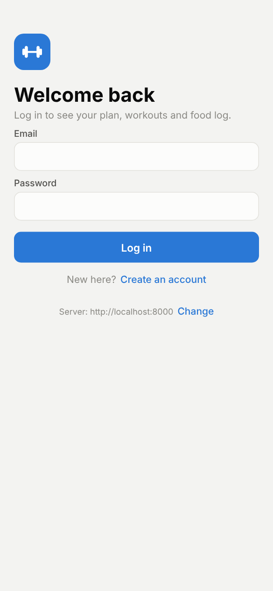
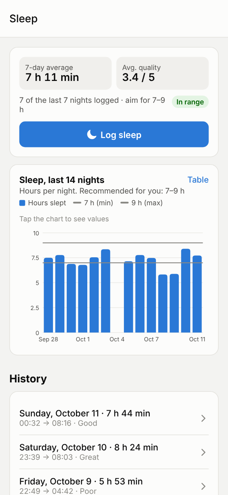

# Fitness App – mobile (React Native)

The phone app, built with **React Native + Expo** (SDK 57) and **Expo Router**. It talks to the FastAPI backend in the folder above.

| Login | Home | Workouts | Food | Progress | Sleep |
|---|---|---|---|---|---|
|  |  |  |  |  |  |

## What you need

- **Node.js 20 or newer** (the LTS version from https://nodejs.org)
- The **backend running** (see the main [README](../README.md))
- To try it on your phone: the free **Expo Go** app (App Store / Google Play), with the phone on the **same Wi-Fi** as your PC

## Run it

**1. Start the backend** so your phone can reach it. In the `fitness-app` folder:
```bash
uv run fastapi dev app/main.py --host 0.0.0.0
```
(`--host 0.0.0.0` lets other devices on your Wi-Fi connect. Without it only your PC can.)

**2. Start the app.** In a second terminal:
```bash
cd fitness-app/mobile
npm install
npx expo start
```
The first `npm install` takes a minute or two. You only need it once (and again after `git pull` if packages changed).

**3. Open it**
- **On your phone:** open Expo Go and scan the QR code shown in the terminal (on iPhone, scan it with the Camera app).
- **In your PC's browser:** press `w` in the terminal. It opens http://localhost:8081.

Log in with **demo@fitness.app / demo1234** (create the demo account first with `uv run python -m app.demo` in the backend folder), or sign up.

## If the phone says "Can't reach the server"

The app guesses the backend address from the PC that runs `npx expo start` (e.g. `http://192.168.1.10:8000`). If that doesn't work:

1. Make sure the backend was started with `--host 0.0.0.0`.
2. **Windows:** the first time, Windows Firewall asks whether to allow Python on networks. Choose **Allow** (private networks). If you missed it, allow port 8000 in *Windows Defender Firewall → Advanced settings → Inbound rules*.
3. On the login screen, tap **Change** next to "Server" and type your PC's address, e.g. `http://192.168.1.10:8000`. Find the address with `ipconfig` (Windows, "IPv4 Address") or `ipconfig getifaddr en0` (Mac).

You can also set it permanently by creating `mobile/.env.local` with:
```
EXPO_PUBLIC_API_URL=http://192.168.1.10:8000
```

If the phone and the PC can't be on the same Wi-Fi, run `npx expo start --tunnel` instead (the backend still needs to be reachable at the address you set).

## Scanning machine QR codes

Workouts → **Start workout** → **Scan QR**. The first time, allow the camera. Print the stickers from Workouts → "Print QR stickers for the machines" (easiest from the browser on your PC). Each sticker also shows its code (e.g. `leg-press`), which can be typed in instead.

## Phone features: what to expect

- **Hands-free sets**: in a set, hold **Hold to say your set**, say "8 reps at 60" (or "10 reps at 22.5 kilos", "same again") and let go. A quick tap starts listening and a second tap saves, which also works with screen readers. The app answers out loud ("Saved: 8 reps at 60 kilos") and says the next set when the rest is over. If the app is in the background then, the rest notification shows the next set instead (on an iPhone with AirPods, turn on Settings → Notifications → Announce Notifications to hear it). It speaks through headphones (wired or Bluetooth) when they're connected, and a Bluetooth headset's microphone is used for listening. Music from other apps is turned down while it speaks. Speech-to-text runs on your PC (Whisper), so the backend must be reachable.
- **Rest notifications**: when the app is in the background, a notification says the rest is over. Local notifications work in Expo Go; nothing is sent through a push server.
- **Photos** (machines, gyms, screenshots, weights, menus) are sent to your own backend only. Choose one from the gallery or take one with the camera.
- **Haptics**: a light tap for choices, a stronger one for a saved set (phones only). They follow the phone's own vibration setting.

## Hands-free workout mode

With a workout in progress, tap **Turn on** under *Hands-free* in the workout card, then talk: "Chat, 12 reps at 25 kilos", "Chat, rest 30 seconds", "Chat, note: my left shoulder feels uncomfortable". The phone listens for speech itself and sends only what you say to Whisper on your PC; the app answers out loud and asks when something is missing. It works with the app open (the screen stays on while it listens); in Expo Go it pauses in the background or with the screen locked. Everything about it, including what a development build would add and a checklist for testing on a phone: [docs/HANDS_FREE.md](../docs/HANDS_FREE.md).

## Commands

```bash
npx expo start          # start the dev server (phone + browser)
npx expo start --web    # open straight in the browser
npm run typecheck       # TypeScript check
npx expo lint           # lint
npm test                # rest timer, progression, spoken sets, hands-free commands, wake word, speech detection
npx expo install <pkg>  # add a package (picks the version that matches the Expo SDK)
```

## Layout

```
mobile/
├── app.json               # app name, icons, permissions (camera)
├── src/
│   ├── app/               # screens (Expo Router: every file is a route)
│   │   ├── _layout.tsx    # providers: login state, theme, toasts
│   │   ├── index.tsx      # sends you to login, profile setup or Home
│   │   ├── login.tsx  signup.tsx  onboarding.tsx  qr-stickers.tsx  sleep.tsx  points.tsx
│   │   └── (tabs)/        # Today, Workouts, Food, Progress, Coach (+ Profile, opened from the avatar on Today)
│   ├── components/        # UI kit, charts, profile form + day picker, workout parts + session provider (rest timer,
│   │                      # guided plan, mini bar), exercise info, gym parts, set helpers (hands-free, weight photo),
│   │                      # snap parts (screenshot import, menu scanner), insights, Today card, points, weekly summary,
│   │                      # sleep dashboard, food parts, first-week checklist
│   └── lib/               # API client, cached server data (TanStack Query: query.ts, data.ts), login state,
│                          # units/formatting, theme + appearance, types, rest timer, progression, spoken-set parser
│                          # (+ tests), voice recording, speech, photos, haptics, notifications
```

**Design system.** Colours, spacing, radii, type sizes, control sizes and motion durations live in `src/lib/theme.ts` (light and dark palettes are chosen separately, not inverted). `src/components/ui.tsx` builds every control from those tokens: buttons, fields, chips, segmented tabs, cards, list rows, sheets, toasts, skeletons and empty states. New screens should use these rather than their own colours or sizes. One accent colour (blue) marks progress and selection; near-black "ink" is for primary actions; green/amber/red are only for status, always with a label or icon. Chart colours are a separate, colour-blind-checked series palette. Animations are short, and skipped when the phone's "reduce motion" setting is on.

Charts are drawn with `react-native-svg` (`src/components/charts.tsx`), so they work in Expo Go and in the browser without extra native code. Tap a chart to see the values; "Table" shows the same numbers as a table.
